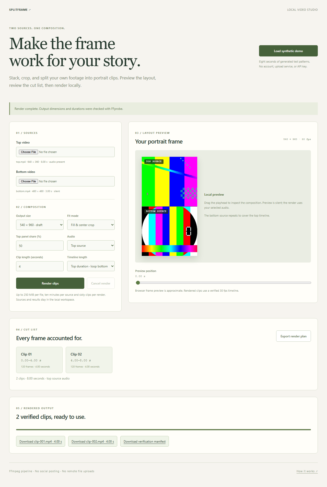

# Splitframe

A local video studio built from the original TikTok-Video-Creator experiment. Compose two videos into a portrait frame, inspect the layout, choose audio and duration behavior, then render a verified set of clips with FFmpeg.



## Run the studio

Install Python 3.10+ and [FFmpeg](https://ffmpeg.org/download.html), with both `ffmpeg` and `ffprobe` available on PATH. Python runtime dependencies are standard-library only.

```sh
python run.py
```

Open <http://127.0.0.1:8840>. Use **Load synthetic demo** or choose two local videos. The demo contains generated test patterns and a synthetic tone; no outside footage or account is involved.

1. Choose 540×960, 720×1280 or 1080×1920 output.
2. Set the panel split, center-crop or letterbox fit, and top/bottom/silent audio.
3. Follow the top duration with a repeating bottom source, or stop at the shorter source.
4. Inspect the silent preview and exact cut list. Export the JSON plan if useful.
5. Render, then download each clip and its verification manifest.

All processing happens on this computer. Browser uploads go only to the loopback server and its local `workspace/` folder. There is no cloud upload, social posting, YouTube downloader, AI service or credential requirement. Output files remain on disk after the server exits; the next session does not automatically reopen them.

## CLI

```sh
python run.py plan --top demo/top.mp4 --bottom demo/bottom.mp4 --clip 4 --size 540
python run.py render --top demo/top.mp4 --bottom demo/bottom.mp4 --clip 4 --size 540 --output output/example
python run.py studio --port 8840 --workspace workspace
```

`render` requires a new output directory and refuses to overwrite an existing one. Source files are never modified. Options: `--fit crop|contain`, `--share 25..75`, `--audio top|bottom|none`, `--length top|shortest`, and `--clip 1..180` seconds. Output is H.264/yuv420p, 30 fps, with AAC when a selected source has audio. A silent selected source yields an explicitly silent plan.

## Pipeline and correctness

`splitframe/engine.py` probes the selected files, computes even panel dimensions, and makes a frame-based cut plan. Every complete output frame belongs to exactly one clip; an exact multiple of the clip length does not create a zero-length tail. A source's sub-frame remainder is discarded when normalizing to 30 fps.

FFmpeg scales and crops/pads each panel, resets timestamps, stacks the results and applies the selected audio. Bottom looping is explicit. Each segment renders to a `.partial.mp4`; only an output with the planned dimensions, audio presence and duration passes verification and receives its final name. `manifest.json` is published only after all clips pass. Cancellation stops the encoder; failed/cancelled folders may retain partial files and logs for diagnosis, and are not offered as successful downloads.

The preview uses browser seeking and CSS fit, so it is approximate and silent. The encoded output and manifest are authoritative. See the [FFmpeg scale/stack filter documentation](https://ffmpeg.org/ffmpeg-filters.html) and [command documentation](https://ffmpeg.org/ffmpeg.html) for the underlying operations.

## Local service boundaries

The server binds to `127.0.0.1`, validates Host/Origin and requires a custom header for mutations. It serves an explicit asset allowlist, opaque uploaded-file IDs, and completed output filenames. The repository, environment files and arbitrary local paths are not browseable. Video routes implement byte ranges for seeking.

Limits are 250 MiB per browser upload, 20 sources and 30 render jobs per session, ten minutes per source, up to 7680-pixel source dimensions, 60 clips per render, and five minutes of encoding time per clip. Only one render runs at once. MP4/MOV and Matroska/WebM containers are supported; encrypted, damaged or unsupported media fails visibly. Files remain in the chosen workspace until you remove them. This is a personal local tool, not a network-facing multi-user service.

## Verify

```sh
python -m unittest discover -s tests -v
npm ci
npx playwright install chromium
npm run test:ui
```

Fourteen Python tests cover segment math, exact/partial boundaries, equal/unequal lengths, argument safety, real audio/video encoding, independently counted output frames, pixel checks for letterboxing/panel colors, in-flight cancellation, upload/probe/byte-range behavior and HTTP rendering. Three browser tests exercise real file inputs, a real two-clip render and manifest download, invalid plans, silent-source behavior, preview controls and 390/1440px layouts. CI installs FFmpeg and runs these same checks. Node is needed only for browser tests.

## Project history

The original MoviePy/pytube experiment had fixed file paths, an equal-duration failure and an empty final segment at exact multiples. Splitframe replaces that runtime with the tested pipeline above. Earlier source is retained as inert text under `legacy/` and in Git history. Captions and remote downloading are not claimed as working features. The repository name is historical; the rendered portrait videos can be used wherever that format is useful.
